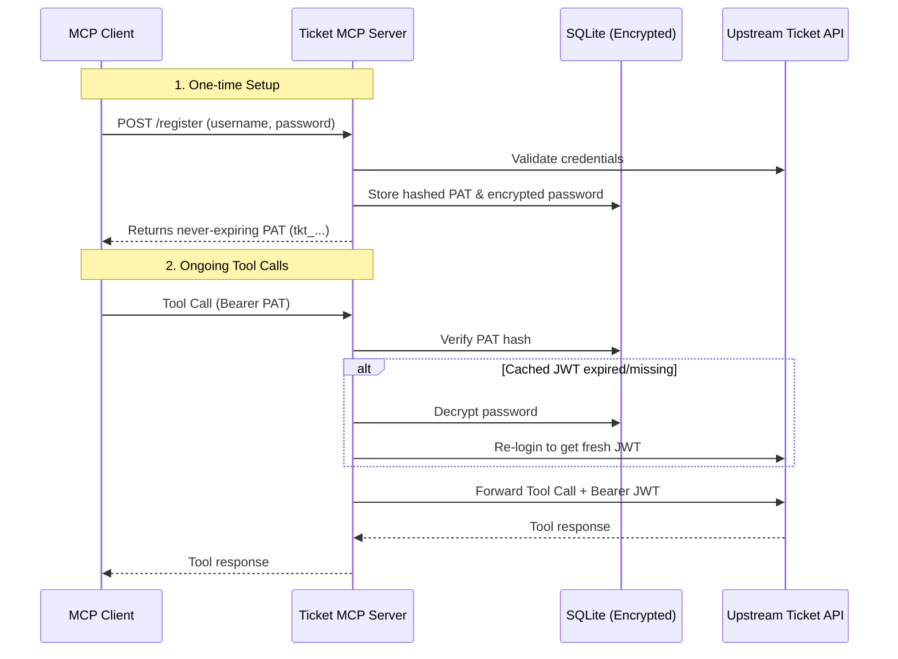

# Ticket API MCP Server

An MCP server exposing the internal **Ticket API** to MCP clients, built with [FastMCP](https://gofastmcp.com)'s OpenAPI integration.

## Architecture & Authentication

The upstream API uses a two-hop auth model (static API Key + per-user short-lived JWT). This server bridges it to MCP clients by minting long-lived Personal Access Tokens (PATs) and transparently handling upstream JWT refresh.



## Running Locally

```bash
pip install -e ".[dev]"
cp .env.example .env   # Fill in keys
ticket-mcp-server

# MCP endpoint:      http://localhost:8000/sse
# Register a PAT:    POST http://localhost:8000/register  {"username": "...", "password": "..."}
# Revoke a PAT:      POST http://localhost:8000/revoke     (Authorization: Bearer <PAT>)
# Health check:      GET  http://localhost:8000/health     (unauthenticated)
```

Connect with any MCP client using the standard SSE transport at `http://localhost:8000/sse` with `Authorization: Bearer <your-tkt_-token>`.

## Running with Docker

```bash
docker build -t ticket-mcp-server .
docker run -p 8000:8000 \
  -v ticket-mcp-data:/app/data \
  -e TICKET_MCP_UPSTREAM_API_KEY=<your-service-key> \
  -e TICKET_MCP_CREDENTIAL_ENCRYPTION_KEY=<your-fernet-key> \
  ticket-mcp-server
```

*(Note: The `-v` volume mount is required to persist PATs across container restarts.)*

## Configuration

Set via environment variables (prefix `TICKET_MCP_`):

| Variable | Required | Default | Description |
|---|---|---|---|
| `TICKET_MCP_UPSTREAM_API_KEY` | **yes** | — | Service-level `X-API-Key` |
| `TICKET_MCP_CREDENTIAL_ENCRYPTION_KEY` | **yes** | — | Fernet key for credentials |
| `TICKET_MCP_UPSTREAM_BASE_URL` | no | `https://hffyacypdj.ap-south-1.awsapprunner.com` | Upstream API base URL |
| `TICKET_MCP_CREDENTIAL_DB_PATH` | no | `./data/credentials.db` | SQLite PAT store |
| `TICKET_MCP_HOST` / `PORT` | no | `0.0.0.0` / `8000` | Bind host/port |

Generate an encryption key:
```bash
python -c "from cryptography.fernet import Fernet; print(Fernet.generate_key().decode())"
```

## Tests

```bash
pip install -e ".[dev]"
pytest -v
```

*(Tests use a mock upstream API to safely exercise the full PAT lifecycle.)*

---
Copyright©️ Codebasics Inc. All rights reserved.
